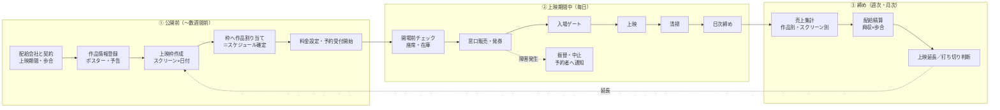

# 映画情報管理システム（三次開発）— 運営フロー整理

作成日：2026-11-10 ／ ブランチ：`feat/admin-management-system` ／ 作成：sigimu
目的：HALシネマ運営側の業務を洗い出し、「いま手作業／未システム化の部分」と「管理システムで担う範囲」を決める。

---

## 1. 現状（二次開発までで出来ているもの）

| 区分 | 状態 |
|------|------|
| エンドユーザー側 | 会員登録・ログイン・映画一覧/詳細・座席予約・決済・QR・フード/グッズ注文・チャットボット → **完成** |
| 管理画面 `admin/` | 発券・フード・グッズ（POS）／入場ゲート（予約確認・通過・座席変更）／枠割り当て（モック）→ **画面のみ、API未接続** |
| 管理者認証 | `sessionStorage` のフラグだけ（サーバー認証なし）。`t_ADMIN` テーブルはあるが未使用 |
| 管理系API | **なし**（`/api/*` はすべて利用者向け） |
| ダッシュボード／バックヤード／設定 | 枠だけ（「サーバー接続後に実装」） |

→ 窓口業務（当日の現場）はモックがあるが、**その手前の「映画を仕入れて上映計画を立てる」業務と、後ろの「売上を締めて配給会社に払う」業務が丸ごと抜けている**。三次開発の主対象はここ。

---

## 2. 登場人物（アクター）と権限

| アクター | 主な業務 | 想定 `f_role` |
|---------|---------|--------------|
| 劇場支配人 | 番組編成の決定、売上確認、配給精算の承認、スタッフ管理 | `manager` |
| 番組編成担当 | 配給会社との契約登録、上映期間・枠割り当て、作品情報登録 | `planner` |
| 窓口・フロアスタッフ | 発券、フード/グッズ販売、入場、座席変更、障害時の振替対応 | `staff` |
| 経理担当 | 日次締め、月次売上集計、配給会社への支払い（歩合） | `accounting` |
| 配給会社（外部） | 作品提供・上映条件提示・精算報告の受領 | システム利用なし（帳票で連携） |

> 権限は「見える・操作できるメニュー」を絞るのに使う。`staff` は窓口系のみ、`manager` は全部。

---

## 3. 業務サイクル全体像



---

## 4. 業務フロー詳細

各フローに「現状」「システム化後」を併記。**★＝三次開発で新規に作るもの**。

### 4-1. 配給・作品管理 ★

| # | 業務 | 現状 | システム化後 |
|---|------|------|-------------|
| 1 | 配給会社の登録 | なし | 配給会社マスタ（社名・担当者・連絡先） |
| 2 | 上映契約の登録 | なし | 作品ごとに「配給会社・上映開始日・終了日（予定）・歩合率・最低保証」を登録 |
| 3 | 作品情報の登録・更新 | `data/movies.json` や SQL 直書き | 管理画面から CRUD（タイトル・上映時間・レーティング・ポスター・予告ID・公開状態） |
| 4 | 公開状態の切替 | `f_is_showing` を手で更新 | 契約期間から自動判定（公開予定／上映中／終了）＋手動上書き |
| 5 | 上映延長・打ち切り | なし | 動員数を見て契約終了日を変更 → 枠割り当てに反映 |

**ポイント**：`f_duration`（上映時間）は枠方式の割り当て判定に必須なので、作品登録時に必須入力にする。

### 4-2. 上映スケジュール管理（枠方式）

| # | 業務 | 現状 | システム化後 |
|---|------|------|-------------|
| 1 | 上映枠の作成 | `admin/schedule.html` モック | スクリーン×期間×テンプレ（3h×3＋4h×1 等）で一括生成 |
| 2 | 作品の割り当て | モック | `上映時間＋清掃20分 ≦ 枠の長さ` を満たす枠だけドロップ可。**契約期間外の作品は割り当て不可** ★ |
| 3 | 料金設定 | `t_SCREEN_PRICE` を直書き | スクリーン・料金区分ごとに設定。特別料金（レイトショー・サービスデー）★ |
| 4 | 予約受付開始 | 手動 | スケジュール確定時に `t_SEAT_STOCK` を初期化 → 公開 |
| 5 | 障害時の振替 | モック | 障害登録 → 空き枠／予備枠へ振替 → 変更履歴 → 予約者通知（DB は設計済み） |

### 4-3. 座席・予約管理

| # | 業務 | 現状 | システム化後 |
|---|------|------|-------------|
| 1 | 予約状況の確認 | ゲート画面で個別確認のみ | 上映回ごとの座席マップ・販売率一覧 ★ |
| 2 | 予約検索 | なし | 予約コード／会員名／電話で検索 ★ |
| 3 | 座席変更 | ゲート画面モック | API 接続（`t_SEAT_STOCK` 更新） |
| 4 | キャンセル・払い戻し | なし | 予約取消 → 座席開放 → 返金ステータス更新 ★ |
| 5 | 販売停止席の設定 | なし | 故障席・関係者席をブロック ★ |

### 4-4. 当日運営（窓口・現場）

| # | 業務 | 現状 | システム化後 |
|---|------|------|-------------|
| 1 | 開場前チェック | なし | 本日の上映一覧・販売数・在庫アラートをダッシュボード表示 |
| 2 | 発券 | モック | 予約QR読取 → 発券 API |
| 3 | フード・グッズ販売 | POS モック | 注文 API ＋ 在庫減算（`t_GOODS.f_stock`） |
| 4 | 入場 | モック | QR 読取 → 入場済み記録（二重入場防止） |
| 5 | 清掃・入替 | 口頭 | 枠の余り時間を「清掃/作業時間」として表示（任意） |

### 4-5. 売上・精算管理 ★

| # | 業務 | 現状 | システム化後 |
|---|------|------|-------------|
| 1 | 日次締め | なし | チケット／フード／グッズ別売上、支払方法別、入場者数を確定 |
| 2 | 作品別興行収入 | なし | 期間・作品・スクリーン別に集計（グラフ） |
| 3 | 配給精算 | なし | `興収 × 歩合率`（最低保証との比較）で支払額算出 → 精算書出力（CSV/PDF） |
| 4 | 物販集計 | なし | 商品別売上・在庫推移・発注目安 |

### 4-6. システム管理

| # | 業務 | システム化後 |
|---|------|-------------|
| 1 | 管理者アカウント | `t_ADMIN` で ID/パスワード認証（JWT・ロール付き）★ |
| 2 | 操作ログ | 誰がいつスケジュール変更・返金したか記録 ★ |
| 3 | マスタ管理 | スクリーン・座席・料金区分・商品 |

---

## 5. 手作業 → システム化で解消する課題

| 課題（手作業の問題点） | 解決方法 |
|----------------------|---------|
| 契約期間外の作品を誤って編成してしまう | 割り当て時に契約期間チェック |
| 上映時間が枠に収まらない編成ミス | 枠方式の自動判定 |
| 配給会社への支払額を手計算 | 興収×歩合の自動算出・精算書出力 |
| 障害時に予約者へ個別連絡 | 振替と同時に通知を自動生成 |
| 売上がチケット・物販で別管理 | 日次締めで一元集計 |
| 管理者ログインがフロントのみ（誰でも入れる） | サーバー側認証＋ロール制御 |

---

## 6. DB 追加・変更候補（次工程で詳細設計）

| 種別 | テーブル | 内容 |
|------|---------|------|
| 新規 | `t_DISTRIBUTOR` | 配給会社マスタ |
| 新規 | `t_SCREENING_CONTRACT` | 上映契約（作品・配給会社・開始日・終了日・歩合率・最低保証） |
| 新規 | `t_DAILY_CLOSING` | 日次締め結果（売上種別ごとの確定値） |
| 新規 | `t_SETTLEMENT` | 配給精算（期間・興収・支払額・ステータス） |
| 新規 | `t_ADMIN_LOG` | 管理操作ログ |
| 新規 | `t_SEAT_BLOCK` | 販売停止席 |
| 変更 | `t_ADMIN.f_role` | `manager / planner / staff / accounting` に整理 |
| 変更 | `t_RESERVATION` | 返金日時・取消理由（キャンセル対応） |
| 変更 | `t_TICKET` | 入場日時（二重入場防止・入場者数集計） |

---

## 7. 管理画面メニュー案（既存＋追加）

> **2026-11-10 更新**：下の案は画面数が多すぎるため、「管理（事務所）」と「現場（端末）」の2区分・7画面に整理した。
> 確定版は [02_design-distribution-sales-auth.md › 画面一覧](02_design-distribution-sales-auth.md#画面一覧)。以下は初期案として残す。

```
ダッシュボード            … 本日の上映・販売率・売上速報・アラート
── 編成 ──
  作品管理 ★              … 作品CRUD・公開状態
  配給・契約管理 ★        … 配給会社・上映契約
  枠割り当て              … （既存モック → API接続）
  料金設定 ★
── 予約 ──
  予約・座席管理 ★        … 上映回別座席マップ・検索・キャンセル
── 窓口 ──
  発券／フード／グッズ／入場ゲート  … （既存モック → API接続）
── 管理 ──
  売上・精算 ★            … 日次締め・作品別興収・配給精算
  商品・在庫（バックヤード）
  設定                    … 管理者アカウント・マスタ・操作ログ
```

---

## 8. 決めたいこと（チームで相談）

1. ~~三次開発のスコープ~~ → **決定（2026-11-10）：配給・作品管理＋売上精算＋管理者認証 に絞る**。詳細は [02_design-distribution-sales-auth.md](02_design-distribution-sales-auth.md)
2. 歩合の計算単位：週ごと（実務に近い）か月ごと（実装が楽）か
3. 返金を扱うか（決済はモックなので「ステータス変更のみ」で良いか）
4. 担当分け：既存 `admin/` モックを作った人とページ単位で被らないように

## 次工程

1. スコープ確定 → 2. ユースケース図・画面遷移図 → 3. DB 詳細設計（`DATABASE.md` 追記）→ 4. 管理 API 設計 → 5. 実装
