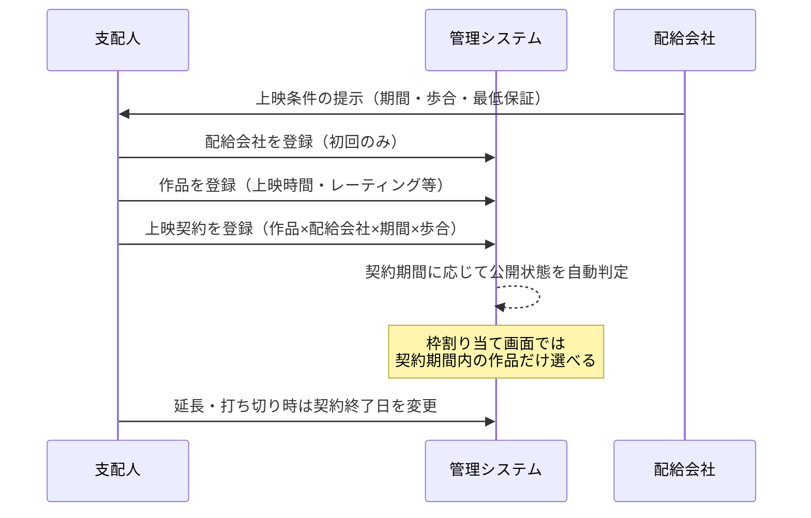
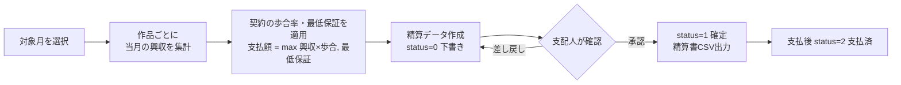
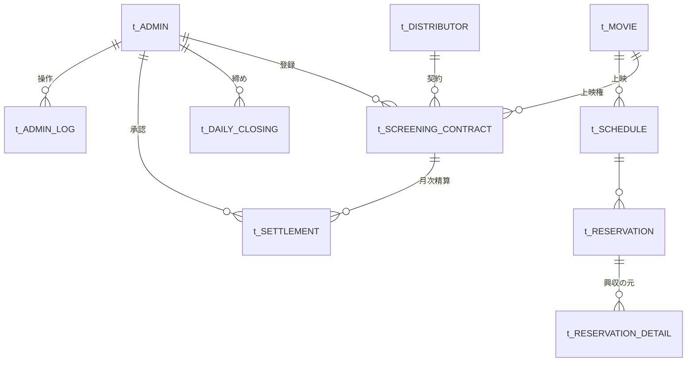

# 映画情報管理システム — 設計書（配給・売上・認証）

作成日：2026-11-10 ／ ブランチ：`feat/admin-management-system` ／ 前工程：[01_operation-flow.md](01_operation-flow.md)

## 0. スコープ

| 対象 | 内容 |
|------|------|
| **A. 管理者認証** | `t_ADMIN` によるサーバー側ログイン、管理者用 JWT、ロール別メニュー |
| **B. 配給・作品管理** | 配給会社マスタ、上映契約、作品 CRUD、公開状態の自動判定 |
| **C. 売上・精算** | ダッシュボード速報、日次締め、作品別興収、配給精算書 |

対象外（今回はやらない）：料金設定画面、予約検索・キャンセル、販売停止席、窓口モックのAPI接続、操作ログ画面（ログの記録だけはやる）。

### 決めた前提（変更する場合はここを直す）

| 項目 | 決定 | 理由 |
|------|------|------|
| 精算単位 | **月次**（作品×月） | 実装が単純。実務は週次が多いが、月の中で週ごとに分けるのは後で足せる |
| 興収の定義 | `t_RESERVATION_DETAIL.f_ticket_price` の合計（税込）、`f_payment_status = 1`（支払済）のみ | 返金済み・未払いは含めない |
| 配給支払額 | `max(興収 × 歩合率, 最低保証額)` | 最低保証なしの契約は 0 を入れる |
| 返金 | 扱わない（ステータスの値は既存のまま） | 決済がモックのため |

---

## A. 管理者認証

### 現状の問題

- `html/login.html` に **管理者 ID/パスワードが平文で直書き**（`ADMIN_CREDENTIALS`）。ソースを見れば誰でも入れる。
- `admin-common.js` は `sessionStorage` のフラグを見ているだけ。API 側の保護はない。

### 方針

1. `POST /api/admin/auth/login`：`f_admin_code` ＋パスワード（bcrypt 照合）→ 管理者 JWT を発行
2. 管理者 JWT の claims：`{ "admin_id": 1, "role": "manager", "typ": "admin", "exp": +8h }`
   - **`typ: "admin"` が無いトークンは管理 API で必ず拒否**（会員の JWT と同じ `JWT_SECRET` で署名しているため、これがないと会員トークンで管理 API を叩けてしまう）
3. `adminMiddleware(roles...)`：`typ` と `role` をチェックし、ctx に `admin_id` / `role` を入れる
4. フロント：`login.html` の直書き判定を削除し、API ログイン → `sessionStorage` に `hal_admin_token` を保存。`admin-common.js` は token の有無＋`GET /api/admin/me` で検証
5. 初期管理者は `schema.sql` の INSERT で投入（パスワードは bcrypt ハッシュ値。平文はREADMEではなく口頭/チーム内で共有）

### ロール

| `f_role` | 名称 | 使える機能 |
|----------|------|-----------|
| `manager` | 支配人 | 全部（管理者アカウント管理を含む） |
| `accounting` | 経理 | ダッシュボード、売上、精算 |
| `staff` | スタッフ | ダッシュボード、窓口系（既存モック） |

作品・配給の登録は `manager` のみ（番組編成担当を分けるほどの人数がいないため）。

---

## B. 配給・作品管理

### 業務の流れ



### 公開状態の判定（`f_is_showing` を自動化）

| 状態 | 条件（今日 = `CURRENT_DATE`） |
|------|------|
| 公開予定 | 有効な契約があり、`今日 < f_start_date` |
| 上映中 | `f_start_date ≦ 今日 ≦ f_end_date` |
| 終映 | すべての契約が `f_end_date < 今日`、または契約なし |

- 既存の `t_MOVIE.f_is_showing` は利用者側 API が使っているので残す。契約の登録・更新時と日付が変わったとき（API 参照時に判定）に更新する。
- 手動で止めたい場合は契約の `f_status = 2`（打ち切り）にする。

### 枠割り当てへの影響

`admin/schedule.html` で作品を選ぶとき、`その日が契約期間内` の作品だけを候補にする（API：`GET /api/admin/movies?showable_on=2026-12-01`）。

---

## C. 売上・精算

### 集計の元データ（既存テーブル）

| 売上種別 | 元テーブル | 条件 | 日付 |
|---------|-----------|------|------|
| チケット | `t_RESERVATION_DETAIL.f_ticket_price` | `t_RESERVATION.f_payment_status = 1` | 上映日 `t_SCHEDULE.f_show_date` |
| フード／グッズ | `t_GOODS_ORDER_DETAIL.f_quantity × f_unit_price` | `t_GOODS_ORDER.f_order_status <> 3` | `f_ordered_at::date` |
| 入場者数 | `t_RESERVATION_DETAIL` の件数 | `t_TICKET.f_ticket_status = 2` | 上映日 |

> チケット売上は「予約した日」ではなく **上映日** に計上する（配給精算が上映日基準のため）。
> フードとグッズの区別は `t_GOODS.f_goods_type` で行いたいが、注文明細の `f_goods_id` が現状 NULL。→ 当面は `t_GOODS_ORDER_DETAIL` に `f_category`（`food`/`goods`）を持たせる（下記 DDL）。

### 日次締め

1. 経理（または支配人）がダッシュボードで「本日の締め」を押す
2. その日の売上を種別ごとに集計し `t_DAILY_CLOSING` に **確定値として保存**（後から予約が変わっても締めた数字は変わらない）
3. 締め済みの日は「締め済み」表示。訂正したい場合は `manager` が「締め解除」→ 再締め

### 月次の配給精算



- 未締めの日が対象月にある場合は警告を出す（締めてから精算する運用）。
- 1作品に契約が複数ある場合（延長で条件変更など）は、契約ごとに上映日で振り分けて集計する。

---

## DB 設計（追加・変更）

既存の命名規則（`t_` / `f_` / `SERIAL` PK / ステータスは `SMALLINT` + `CHECK`）に合わせる。

### 新規：t_DISTRIBUTOR（配給会社）

```sql
CREATE TABLE t_DISTRIBUTOR (
    f_distributor_id  SERIAL        PRIMARY KEY,
    f_name            VARCHAR(100)  NOT NULL,
    f_contact_name    VARCHAR(50),
    f_email           VARCHAR(255),
    f_phone           VARCHAR(20),
    f_is_active       SMALLINT      NOT NULL DEFAULT 1 CHECK (f_is_active IN (0, 1)),
    f_created_at      TIMESTAMP     NOT NULL DEFAULT CURRENT_TIMESTAMP
);
```

### 新規：t_SCREENING_CONTRACT（上映契約）

```sql
CREATE TABLE t_SCREENING_CONTRACT (
    f_contract_id        SERIAL        PRIMARY KEY,
    f_movie_id           INTEGER       NOT NULL REFERENCES t_MOVIE       (f_movie_id),
    f_distributor_id     INTEGER       NOT NULL REFERENCES t_DISTRIBUTOR (f_distributor_id),
    f_start_date         DATE          NOT NULL,
    f_end_date           DATE          NOT NULL,
    f_revenue_share      NUMERIC(5,2)  NOT NULL                 -- 歩合率(%) 例: 50.00
        CHECK (f_revenue_share BETWEEN 0 AND 100),
    f_minimum_guarantee  INTEGER       NOT NULL DEFAULT 0,      -- 最低保証額(円)
    f_status             SMALLINT      NOT NULL DEFAULT 0       -- 0:有効 / 1:終了 / 2:打ち切り
        CHECK (f_status IN (0, 1, 2)),
    f_note               VARCHAR(255),
    f_created_by         INTEGER       REFERENCES t_ADMIN (f_admin_id),
    f_created_at         TIMESTAMP     NOT NULL DEFAULT CURRENT_TIMESTAMP,

    CONSTRAINT ck_contract_period CHECK (f_start_date <= f_end_date)
);

CREATE INDEX idx_contract_movie  ON t_SCREENING_CONTRACT (f_movie_id);
CREATE INDEX idx_contract_period ON t_SCREENING_CONTRACT (f_start_date, f_end_date);
```

> 同じ作品で期間が重なる有効な契約はアプリ側で弾く（延長は「終了日の変更」か「前の契約を終了して新契約」）。

### 新規：t_DAILY_CLOSING（日次締め）

```sql
CREATE TABLE t_DAILY_CLOSING (
    f_closing_date    DATE       PRIMARY KEY,
    f_ticket_sales    INTEGER    NOT NULL,
    f_food_sales      INTEGER    NOT NULL,
    f_goods_sales     INTEGER    NOT NULL,
    f_ticket_count    INTEGER    NOT NULL,     -- 販売枚数
    f_admission_count INTEGER    NOT NULL,     -- 入場者数
    f_closed_by       INTEGER    NOT NULL REFERENCES t_ADMIN (f_admin_id),
    f_closed_at       TIMESTAMP  NOT NULL DEFAULT CURRENT_TIMESTAMP
);
```

締め解除 = 行を削除（操作ログに残す）。

### 新規：t_SETTLEMENT（配給精算）

```sql
CREATE TABLE t_SETTLEMENT (
    f_settlement_id   SERIAL     PRIMARY KEY,
    f_contract_id     INTEGER    NOT NULL REFERENCES t_SCREENING_CONTRACT (f_contract_id),
    f_target_month    DATE       NOT NULL,          -- 対象月の1日（2026-12-01）
    f_box_office      INTEGER    NOT NULL,          -- 興収（その契約・その月）
    f_admission_count INTEGER    NOT NULL,
    f_revenue_share   NUMERIC(5,2) NOT NULL,        -- 計算時点の歩合率（スナップショット）
    f_payment_amount  INTEGER    NOT NULL,          -- 支払額
    f_status          SMALLINT   NOT NULL DEFAULT 0 -- 0:下書き / 1:確定 / 2:支払済
        CHECK (f_status IN (0, 1, 2)),
    f_approved_by     INTEGER    REFERENCES t_ADMIN (f_admin_id),
    f_approved_at     TIMESTAMP,
    f_paid_at         TIMESTAMP,
    f_created_at      TIMESTAMP  NOT NULL DEFAULT CURRENT_TIMESTAMP,

    CONSTRAINT uq_settlement UNIQUE (f_contract_id, f_target_month)
);
```

### 新規：t_ADMIN_LOG（操作ログ）

```sql
CREATE TABLE t_ADMIN_LOG (
    f_log_id      SERIAL        PRIMARY KEY,
    f_admin_id    INTEGER       NOT NULL REFERENCES t_ADMIN (f_admin_id),
    f_action      VARCHAR(50)   NOT NULL,   -- 'login' / 'contract.create' / 'closing.undo' 等
    f_target      VARCHAR(100),             -- 'contract:12' 等
    f_detail      TEXT,                     -- 変更前後のJSONなど
    f_created_at  TIMESTAMP     NOT NULL DEFAULT CURRENT_TIMESTAMP
);

CREATE INDEX idx_admin_log_created ON t_ADMIN_LOG (f_created_at);
```

### 変更

```sql
-- ロールを3種に限定
ALTER TABLE t_ADMIN
    ADD CONSTRAINT ck_admin_role CHECK (f_role IN ('manager', 'accounting', 'staff')),
    ADD COLUMN f_is_active    SMALLINT  NOT NULL DEFAULT 1 CHECK (f_is_active IN (0, 1)),
    ADD COLUMN f_last_login_at TIMESTAMP;

-- フード/グッズ売上を分けるため
ALTER TABLE t_GOODS_ORDER_DETAIL
    ADD COLUMN f_category VARCHAR(10) NOT NULL DEFAULT 'food'
        CHECK (f_category IN ('food', 'goods'));
```

### ER（追加分）



---

## 画面一覧

管理画面は **「管理（事務所）」と「現場（端末）」の2区分・計7画面＋ログイン** に整理する（2026-11-10 決定）。
重複していた画面は統合し、関連する機能は画面を分けずにタブで切り替える。

### 管理（事務所）

| ID | 画面 | ファイル | ロール | タブ／主な操作 |
|----|------|---------|-------|---------------|
| G01 | 管理者ログイン | `html/login.html`（改修） | — | ID/パスワード → API ログイン |
| G02 | ダッシュボード | `admin/index.html`（改修） | 全員 | 本日の売上速報・上映中作品・未締めアラート・在庫アラート（旧バックヤードを統合） |
| G03 | 作品・配給 | `admin/movies.html`（新規） | manager | **作品** タブ：一覧・登録・編集・公開状態<br>**配給会社** タブ：登録・編集<br>**契約** タブ：上映期間・歩合・最低保証、延長・打ち切り |
| G04 | 枠割り当て | `admin/schedule.html`（既存） | manager | 契約期間内の作品だけ候補に出す（API接続時） |
| G05 | 売上・精算 | `admin/sales.html`（新規） | manager, accounting | **日次締め** タブ／**売上集計** タブ（期間・作品・スクリーン別グラフ）／**配給精算** タブ（月選択→計算→承認→CSV） |
| G06 | 設定 | `admin/settings.html`（改修） | manager | 管理者アカウントの追加・無効化・ロール変更 |

### 現場（端末）※今回のスコープ外。統合はモック作成者と相談のうえ

| ID | 画面 | ファイル | ロール | 統合元 |
|----|------|---------|-------|-------|
| G07 | 窓口（入場ゲート） | `admin/gate.html`（既存） | 全員 | 入場ゲートのみ：QR読取 → 予約確認／入場／座席変更。発券機は作らない（電子チケットのQRでそのまま入場） |
| G08 | 物販 | `admin/shop.html` | 全員 | フード（`food.html`）＋グッズ（`goods.html`）：フード／グッズ切替＋受付・受理中・在庫・POS・履歴 |

### 廃止

| 画面 | 理由 |
|------|------|
| ~~`backyard.html`~~ | ~~ダッシュボードと内容が重複 → G02 へ統合~~ → 2026-11-17 に一度 G09 として分けたが、**2026-11-24 画面設計書（xlsx）に合わせて G02 ダッシュボードに統合**。在庫・発注／商品／シフト／清掃・設備はダッシュボードのタブ。[03_screen-design.md](03_screen-design.md) 参照 |
| `ticket.html`（発券） | 発券機は作らない（2026-11-10 決定）。入場は電子チケットのQRで行う |
| `food.html` / `goods.html` | G08 物販へ統合（現場側の作業時） |

### ロール別メニュー（`admin-common.js` で出し分け）

| ロール | 表示されるメニュー |
|-------|------------------|
| manager | ダッシュボード／作品・配給／枠割り当て／売上・精算／設定／窓口／物販 |
| accounting | ダッシュボード／売上・精算 |
| staff | ダッシュボード／窓口／物販 |

---

## API 一覧（すべて `/api/admin` 配下、管理者 JWT 必須）

| メソッド | パス | ロール | 内容 |
|---------|------|-------|------|
| POST | `/api/admin/auth/login` | （不要） | ログイン → JWT |
| GET | `/api/admin/me` | 全員 | ログイン中の管理者 |
| GET | `/api/admin/dashboard?date=` | 全員 | 当日の売上速報・上映数・未締め日 |
| GET/POST | `/api/admin/movies` | manager | 作品一覧（`?showable_on=` で契約期間フィルタ）／登録 |
| PATCH/DELETE | `/api/admin/movies/{id}` | manager | 更新／削除（上映実績があれば論理削除） |
| GET/POST | `/api/admin/distributors` | manager | 配給会社 |
| PATCH | `/api/admin/distributors/{id}` | manager | |
| GET/POST | `/api/admin/contracts` | manager | 契約（`?movie_id=` `?active_on=`） |
| PATCH | `/api/admin/contracts/{id}` | manager | 期間延長・打ち切り |
| GET | `/api/admin/sales?from=&to=&group=day\|movie\|screen` | manager, accounting | 売上集計 |
| POST | `/api/admin/closings/{date}` | manager, accounting | 日次締め |
| DELETE | `/api/admin/closings/{date}` | manager | 締め解除 |
| POST | `/api/admin/settlements/calculate?month=2026-12` | manager, accounting | 下書き作成（再計算は下書きのみ上書き） |
| GET | `/api/admin/settlements?month=` | manager, accounting | 一覧 |
| PATCH | `/api/admin/settlements/{id}` | manager | 承認（1）／支払済（2） |
| GET | `/api/admin/settlements/export?month=` | manager, accounting | CSV |
| GET/POST/PATCH | `/api/admin/admins` | manager | 管理者アカウント |

バックエンドは既存構成に合わせ `backend/internal/admin/` 配下に `auth.go` `movies.go` `contracts.go` `sales.go` `settlements.go` を置く想定。

---

## 実装順と担当分けの案

| 順 | 内容 | 依存 |
|----|------|------|
| 1 | DDL 追加（`schema.sql`・`DATABASE.md` 追記）＋初期管理者・配給会社のサンプルデータ | — |
| 2 | 管理者認証（API・middleware・login.html・admin-common.js） | 1 |
| 3 | 作品・配給（G03：API・画面） | 2 |
| 4 | 売上・精算の日次締め／売上集計タブ＋ダッシュボード（G05・G02） | 2 |
| 5 | 売上・精算の配給精算タブ・CSV（G05） | 3, 4 |
| 6 | （スコープ外・相談）物販の統合（G08）、`backyard.html`・`ticket.html` 削除 | — |

3 と 4 は並行可能（触るファイルが別）。

## 残っている相談事項

- 精算単位を月次にしたが、週次にしたいか
- 興収を税込のまま扱うか（税抜で精算する場合は `/1.1` を計算に入れる）
- 作品の削除：上映実績がある作品は削除不可＋非表示フラグ、で良いか
