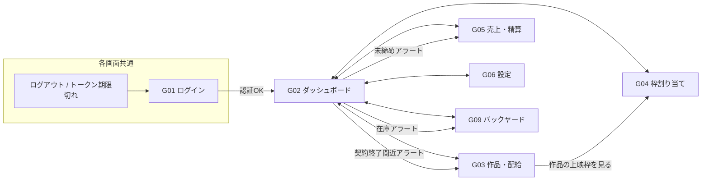

# 映画情報管理システム — 画面設計書（管理・事務所側）

作成日：2026-11-17 ／ ブランチ：`docs/admin-screen-design` ／ 作成：sigimu
前工程：[01_operation-flow.md](01_operation-flow.md) → [02_design-distribution-sales-auth.md](02_design-distribution-sales-auth.md)

対象：**G01〜G06・G09（管理・事務所）**。現場端末（G07 窓口・G08 物販）はスコープ外。

---

## 1. 画面遷移図



- 画面間の移動はすべてサイドバーから。画面内の切替は **タブ**（URLハッシュ `#movies` `#contracts` 等で直接開ける）。
- 登録・編集は **モーダル**（別画面に遷移しない）。
- ロール外の画面をURL直打ちした場合 → G02 に戻して「権限がありません」トースト。

---

## 2. 共通レイアウト（既存 `admin.css` を流用）

```
┌──────────────┬───────────────────────────────────────────────┐
│ HAL CINEMA   │ ☰  管理者画面 › 作品・配給       山田(支配人) [ログアウト] │ ← topbar
│ 管理者画面   ├───────────────────────────────────────────────┤
│              │  ページタイトル                    [主ボタン]  │
│ 概要         │  ┌タブ1┐┌タブ2┐┌タブ3┐                       │
│  ダッシュボード│  ─────────────────────────────                │
│ 編成         │  検索・絞り込みバー                            │
│  作品・配給  │  ┌────────────────────────────────┐         │
│  枠割り当て  │  │ 一覧テーブル / カード                  │         │
│ 経理         │  └────────────────────────────────┘         │
│  売上・精算  │                                               │
│  バックヤード│                                               │
│ 現場         │                                               │
│  窓口        │                                               │
│  物販        │                                               │
│ システム     │                                               │
│  設定        │                                               │
└──────────────┴───────────────────────────────────────────────┘
```

### サイドバー（ロールで出し分け）

| セクション | 項目 | manager | accounting | staff |
|-----------|------|:------:|:----------:|:-----:|
| 概要 | ダッシュボード | ○ | ○ | ○ |
| 編成 | 作品・配給 | ○ | | |
| 編成 | 枠割り当て | ○ | | |
| 経理 | 売上・精算 | ○ | ○ | |
| 運営 | バックヤード | ○ | | ○ |
| 現場 | 窓口 | ○ | | ○ |
| 現場 | 物販 | ○ | | ○ |
| システム | 設定 | ○ | | |

- `admin-common.js` が `GET /api/admin/me` の `role` を見て、`data-roles="manager,accounting"` 属性を持つ `<li>` だけ表示する。
- 旧メニュー（発券・フード・グッズ）は削除。バックヤードは G09 として作り直す（2026-11-17 変更：ダッシュボードとは分ける）。

### 共通部品

| 部品 | 仕様 |
|------|------|
| トップバー右 | `管理者名（ロール名）` ＋ ログアウト |
| トースト | 右上。成功＝緑 3秒で消える／エラー＝赤 手動で閉じる |
| 確認ダイアログ | 削除・締め解除・承認・打ち切りなど**戻せない操作**は必ず出す |
| モーダル | 幅 560px。`Esc`・背景クリックで閉じる（入力中なら「破棄しますか？」） |
| 空状態 | 一覧が0件のとき「まだ登録がありません」＋登録ボタン |
| 読み込み中 | テーブル部分にスケルトン表示 |
| API エラー | 401 → G01 へ／403 → 「権限がありません」／5xx → 「サーバーに接続できません」トースト |
| 金額表示 | `¥1,234,000`（右寄せ）。歩合は `50.0%` |
| 日付表示 | `2026/12/01（火）` |

---

## 3. 画面詳細

### G01 管理者ログイン　`html/login.html`（改修）

```
        ┌─────────────────────────────┐
        │        HAL CINEMA           │
        │       管理者ログイン         │
        │                             │
        │  管理者ID  [____________]   │
        │  パスワード [____________] 👁 │
        │                             │
        │  ⚠ IDまたはパスワードが違います │
        │                             │
        │      [  ログイン  ]          │
        │                             │
        │  会員の方はこちら →          │
        └─────────────────────────────┘
```

| 項目 | 種類 | 必須 | 入力チェック |
|------|------|:---:|-------------|
| 管理者ID | text | ○ | 空欄不可・50文字以内 |
| パスワード | password | ○ | 空欄不可。表示切替ボタンあり |

| 操作 | 処理 |
|------|------|
| ログイン | `POST /api/admin/auth/login` → `hal_admin_token` を sessionStorage に保存 → G02 |
| 失敗 | 「IDまたはパスワードが違います」（どちらが違うかは出さない） |
| 無効化されたアカウント | 同じメッセージ（存在を推測させない） |

- 既存の `ADMIN_CREDENTIALS` 直書きは削除。
- 会員ログインと同じファイルを使う場合はタブで「会員／管理者」を切り替え（現行どおり）。

---

### G02 ダッシュボード　`admin/index.html`（改修）

「今日の状況をひと目で見る」画面。**見るだけ**で、在庫の入力などの作業は G09 バックヤードで行う。

```
ダッシュボード                         2026/12/01（火）  [◀][▶]
┌──────────┐┌──────────┐┌──────────┐┌──────────┐
│チケット売上││フード売上  ││グッズ売上  ││入場者数    │
│ ¥482,000 ││ ¥96,500  ││ ¥38,200  ││ 312 / 420│
│前週比 +8% ││          ││          ││ 販売率 74%│
└──────────┘└──────────┘└──────────┘└──────────┘

┌ アラート ───────────────────────────────────────┐
│ ⚠ 11/29（日）が未締めです            [締めに行く →]│
│ ⚠ 「〇〇〇」の契約が 12/05 で終了します [契約を見る →]│
│ ⚠ ポップコーン塩L 在庫残り 8     [バックヤードへ →]│
└─────────────────────────────────────────────┘

┌ 本日の上映 ─────────────────────────────────────┐
│ 時刻  スクリーン  作品           販売   状態      │
│ 10:00  SCREEN 1   〇〇〇         82/120 ■■■■□ 上映済│
│ 13:20  SCREEN 1   〇〇〇         64/120 ■■■□□ 上映中│
│ 16:40  SCREEN 2   △△△          12/80  ■□□□□ 販売中│
└─────────────────────────────────────────────┘

┌ 本日の締め ──────────────┐
│ 状態：未締め               │
│ [ 本日の締めを実行 ]       │  ← manager / accounting のみ表示
└──────────────────────────┘
```

| 表示項目 | 元データ | 備考 |
|---------|---------|------|
| チケット売上 | 上映日＝表示日、支払済の `f_ticket_price` 合計 | 前週同曜日比 |
| フード／グッズ売上 | `t_GOODS_ORDER_DETAIL`（`f_category` 別） | |
| 入場者数 | `t_TICKET.f_ticket_status = 2` の件数 / 販売枚数 | |
| アラート | 未締め日（過去7日）・契約終了7日以内・在庫が発注点以下・清掃未完了 | 0件なら「アラートはありません」 |
| 本日の上映 | `t_SCHEDULE` × `t_SEAT_STOCK` | 状態は時刻から判定 |

- 日付は前後に移動可（過去の速報確認用）。未来日は売上カードを「—」表示。
- staff には売上カードを出さず、上映一覧と入場者数のみ（**要相談**）。
- API：`GET /api/admin/dashboard?date=YYYY-MM-DD`

---

### G03 作品・配給　`admin/movies.html`（新規）　manager のみ

タブ：**作品** ｜ **配給会社** ｜ **契約**

#### G03-1 作品タブ

```
作品・配給                                      [＋ 作品を登録]
[作品] [配給会社] [契約]
────────────────────────────────────────────
検索 [タイトル______]  状態 [すべて▼]  ジャンル [すべて▼]

ポスター  タイトル            上映時間  区分  公開状態   契約期間          操作
[img]    〇〇〇             128分   G    ●上映中   11/01〜12/05   [編集]
[img]    △△△              95分    PG12 ○公開予定 12/10〜01/31   [編集]
[img]    □□□             110分    G    ―終映     09/01〜10/31   [編集]
                                                       ‹ 1 2 3 ›
```

**登録・編集モーダル**

| 項目 | DB | 種類 | 必須 | 入力チェック |
|------|----|------|:---:|-------------|
| タイトル | `f_title` | text | ○ | 200文字以内 |
| 英題 | `f_title_en` | text | | 200文字以内 |
| ジャンル | `f_genre` | select | ○ | |
| 上映時間（分） | `f_duration` | number | ○ | 1〜300。**枠割り当てに必須** |
| レーティング | `f_rating` | select | ○ | G / PG12 / R15+ / R18+ |
| 公開日 | `f_release_date` | date | ○ | |
| 監督 | `f_director` | text | | |
| キャスト | `f_cast_info` | text | | 300文字以内・カンマ区切り |
| あらすじ | `f_synopsis` | textarea | | |
| 上映形式 | `f_formats` | checkbox | | 2D / 3D / IMAX / 4DX |
| ポスター | `f_poster_slug` | file + プレビュー | | jpg/png/webp・1MB以内 |
| 予告編ID | `f_trailer_id` | text | | YouTube ID 11文字。入力するとサムネイル表示 |

- 公開状態は**表示のみ**（契約から自動判定）。手で止めたいときは契約タブで「打ち切り」。
- 削除：上映実績がある作品は「削除」ボタンを出さず「非表示にする」（**要相談**）。

#### G03-2 配給会社タブ

```
[作品] [配給会社] [契約]                         [＋ 配給会社を登録]
社名               担当者     連絡先                 契約中の作品  状態   操作
〇〇映画配給        佐藤       03-xxxx / sato@…      2本         有効   [編集]
△△ピクチャーズ     鈴木       06-xxxx / …           0本         無効   [編集]
```

| 項目 | DB | 必須 | チェック |
|------|----|:---:|---------|
| 社名 | `f_name` | ○ | 100文字以内・重複不可 |
| 担当者名 | `f_contact_name` | | |
| メール | `f_email` | | メール形式 |
| 電話 | `f_phone` | | 数字とハイフン |
| 有効 | `f_is_active` | | トグル。無効にすると契約登録の候補に出ない |

#### G03-3 契約タブ

```
[作品] [配給会社] [契約]                           [＋ 契約を登録]
状態 [有効▼]  作品 [すべて▼]  配給会社 [すべて▼]

作品        配給会社      期間                  歩合   最低保証   状態     操作
〇〇〇      〇〇映画配給  11/01〜12/05 (残4日)  50.0%  ¥300,000 ●有効   [延長][打ち切り]
△△△       △△ピクチャーズ 12/10〜01/31         45.0%  ¥0       ●有効   [編集]
□□□       〇〇映画配給  09/01〜10/31          50.0%  ¥200,000 ―終了
```

**登録モーダル**

| 項目 | DB | 必須 | チェック |
|------|----|:---:|---------|
| 作品 | `f_movie_id` | ○ | select（検索付き） |
| 配給会社 | `f_distributor_id` | ○ | 有効な会社のみ |
| 上映開始日 | `f_start_date` | ○ | |
| 上映終了日 | `f_end_date` | ○ | 開始日以降 |
| 歩合率（%） | `f_revenue_share` | ○ | 0〜100、小数1桁 |
| 最低保証額（円） | `f_minimum_guarantee` | | 0以上。未入力は0 |
| 備考 | `f_note` | | 255文字以内 |

- 同じ作品で期間が重なる有効契約がある → 「期間が既存の契約（11/01〜12/05）と重なっています」で保存不可。
- **延長**：終了日だけ変更できる小モーダル。短縮で既に割り当て済みの上映枠が外れる場合は「12/06以降の上映 3回 が契約期間外になります」と警告。
- **打ち切り**：確認ダイアログ → `f_status = 2`。以降の上映枠は枠割り当て画面で「契約外」表示。
- 精算済み（`t_SETTLEMENT.f_status ≧ 1`）がある月にかかる変更は不可。

---

### G04 枠割り当て　`admin/schedule.html`（既存・改修点のみ）

既存モックの画面構成はそのまま。変更点：

| # | 変更 |
|---|------|
| 1 | 右の作品リストを `GET /api/admin/movies?showable_on=<表示日>` で取得。契約期間外の作品は出さない |
| 2 | 作品リストに「契約残り日数」を小さく表示（7日以内は橙） |
| 3 | 契約が打ち切られた作品の割り当て済み枠は斜線＋「契約外」バッジ |
| 4 | manager 以外はアクセス不可 |

---

### G05 売上・精算　`admin/sales.html`（新規）　manager / accounting

タブ：**日次締め** ｜ **売上集計** ｜ **配給精算**

#### G05-1 日次締めタブ

```
売上・精算
[日次締め] [売上集計] [配給精算]
────────────────────────────────────────────
対象月 [2026年12月 ▼]

日付        チケット    フード    グッズ    合計        入場/販売  状態              操作
12/01(火)  ¥482,000  ¥96,500  ¥38,200  ¥616,700   312/420   ✔締め済(山田 22:10) [解除]
12/02(水)  ¥351,000  ¥70,100  ¥22,000  ¥443,100   240/301   未締め            [締める]
12/03(木)  —         —        —        —          —         （未来）
──────────────────────────────────────────────────────────────
月計       ¥833,000  …                                     未締め 1日
```

| 操作 | ロール | 処理 |
|------|-------|------|
| 締める | manager, accounting | 確認ダイアログに集計値を表示 →「この金額で確定します」→ `POST /closings/{date}` |
| 解除 | manager のみ | 「解除すると再集計されます」確認 → `DELETE`。操作ログに記録 |

- 締め済みの行は**保存された確定値**、未締めは**その時点の集計値（灰色文字）**を表示。
- 今日以前の未締めは行を薄い黄色でハイライト。

#### G05-2 売上集計タブ

```
期間 [2026/12/01]〜[2026/12/31]   切り口 (●日別 ○作品別 ○スクリーン別)   [CSV]

┌ グラフ ──────────────────────────────────────┐
│ 日別：積み上げ棒（チケット/フード/グッズ）            │
│ 作品別・スクリーン別：横棒（興収の多い順）           │
└──────────────────────────────────────────────┘

┌ 表 ────────────────────────────────────────┐
│ 作品別のとき：作品 / 上映回数 / 動員 / 興収 / 平均単価 / 座席稼働率 │
└──────────────────────────────────────────────┘
```

- 期間の初期値：当月1日〜今日。最大1年。
- API：`GET /api/admin/sales?from=&to=&group=day|movie|screen`

#### G05-3 配給精算タブ

```
対象月 [2026年12月 ▼]   [精算を計算する]        ⚠ 未締めの日が 2日 あります

作品     配給会社       興収         動員   歩合   興収×歩合   最低保証   支払額       状態      操作
〇〇〇   〇〇映画配給   ¥2,480,000  1,820  50.0% ¥1,240,000 ¥300,000  ¥1,240,000  下書き   [承認]
△△△    △△ピクチャーズ ¥  420,000    310  45.0% ¥  189,000 ¥300,000  ¥  300,000※ 確定     [支払済]
──────────────────────────────────────────────────────────────────
合計                    ¥2,900,000                                     ¥1,540,000
※ 最低保証を適用                                          [精算書CSVを出力]
```

| 操作 | ロール | 処理 |
|------|-------|------|
| 精算を計算する | manager, accounting | 下書きを作成／**下書きのみ**再計算で上書き。未締めの日があれば警告ダイアログ（続行可） |
| 承認 | manager | 確認 → `f_status = 1`。以後再計算されない |
| 支払済 | manager | 支払日を入力 → `f_status = 2` |
| CSV出力 | manager, accounting | 確定・支払済の行のみ出力。下書きのみの月はボタン無効 |

- 支払額が最低保証で決まった行は `※` と注記。
- 状態の色：下書き＝灰／確定＝青／支払済＝緑。

---

### G06 設定　`admin/settings.html`（改修）　manager のみ

```
設定
[管理者アカウント] [操作ログ]                          [＋ アカウントを追加]

管理者ID    名前     ロール      最終ログイン        状態   操作
manager01   山田     支配人      12/01 09:02        有効   [編集]
acct01      田中     経理        11/30 18:40        有効   [編集]
staff03     高橋     スタッフ    —                  無効   [編集]
```

| 項目 | DB | 必須 | チェック |
|------|----|:---:|---------|
| 管理者ID | `f_admin_code` | ○ | 半角英数4〜20文字・重複不可。**編集時は変更不可** |
| 名前 | `f_admin_name` | ○ | 50文字以内 |
| ロール | `f_role` | ○ | 支配人／経理／スタッフ |
| パスワード | `f_password` | 新規時○ | 8文字以上・英数混在。編集時は空欄なら変更しない |
| 有効 | `f_is_active` | | トグル |

- **自分自身**のロール変更・無効化は不可（支配人がいなくなるのを防ぐ）。
- 有効な manager が1人だけのとき、その人を無効化・降格できない。
- 操作ログタブ：日時／管理者／操作／対象 の一覧（閲覧のみ、期間と管理者で絞り込み）。**記録は必須、画面は余裕があれば**。

---

### G09 バックヤード　`admin/backyard.html`（作り直し）　manager / staff

裏方の作業をまとめる画面。タブ：**在庫・発注** ｜ **商品** ｜ **シフト** ｜ **清掃・設備**

#### G09-1 在庫・発注タブ

```
在庫・発注                               [入荷を記録] [発注リストCSV]
区分 [すべて▼]  □ 発注が必要なものだけ

商品            区分     在庫    発注点   直近7日の販売  残り日数  状態        操作
ポップコーン塩L  フード    8個    20      182個          0.3日   ⚠発注      [入荷][調整]
コーラM         ドリンク  140杯  50      260杯          3.8日   ○          [入荷][調整]
アクリルスタンド グッズ    12個   10      9個            9.3日   ○          [入荷][調整]
```

| 項目 | 元データ | 備考 |
|------|---------|------|
| 在庫 | `t_GOODS.f_stock` | |
| 発注点 | `t_GOODS.f_stock_alert_threshold` | これ以下で「発注」表示 |
| 直近7日の販売 | `t_GOODS_ORDER_DETAIL` | |
| 残り日数 | 在庫 ÷ (7日販売 / 7) | 2日未満は赤 |

| 操作 | 処理 |
|------|------|
| 入荷 | 数量を入力 → 在庫に加算。履歴に残す |
| 調整 | 廃棄・棚卸しの差分。理由（廃棄／棚卸し／その他）必須 |
| 発注リストCSV | 発注が必要な商品と、7日分の販売に足りない数を出力 |

#### G09-2 商品タブ

| 項目 | DB | 必須 | チェック |
|------|----|:---:|---------|
| 商品名 | `f_goods_name` | ○ | 200文字以内 |
| 区分 | `f_goods_type` | ○ | フード／ドリンク／グッズ |
| 価格 | `f_price` | ○ | 0以上の整数 |
| 単位 | `f_stock_unit` | ○ | 個／杯 など |
| 発注点 | `f_stock_alert_threshold` | ○ | 0以上 |
| 販売中 | `f_is_active` | | オフにすると物販・注文画面に出ない |

#### G09-3 シフトタブ

```
シフト   [◀ 12/01〜12/07 ▶]                              [＋ シフトを追加]
         12/01(火) 12/02(水) 12/03(木) …
山田     9-18 事務  休         9-18 事務
高橋     10-19 窓口 10-19 窓口 休
佐々木   14-23 物販 14-23 物販 14-23 清掃
──────
本日の配置：窓口 2名 ／ 物販 2名 ／ 清掃 1名（不足：清掃 −1）
```

- 週表示。セルをクリックで「開始・終了・持ち場（窓口／物販／清掃／事務）」を編集。
- 持ち場ごとの必要人数を下回る日は赤字で「不足」。

#### G09-4 清掃・設備タブ

```
本日の清掃チェック（12/02）
上映回            スクリーン  終了    清掃     担当     
10:00 ゴジラ-1.0  SCREEN 3   12:05  ✔ 完了  佐々木 12:20
13:20 ゴジラ-1.0  SCREEN 3   15:25  [完了にする]
…

設備の不具合                                          [＋ 報告する]
日時         場所        内容                 状態        操作
12/01 18:30 SCREEN 2   F-5 座席のリクライニング不良  対応中   [解決]
```

- 清掃は G04 枠割り当てで決まった上映回ごとに1行。終了時刻を過ぎて未完了の行は黄色。
- 不具合の報告で「座席」を選ぶと、その席を販売停止にするかを選べる（`t_SEAT_BLOCK` と連携・後回し可）。

#### 追加が必要なテーブル（候補）

| テーブル | 内容 |
|---------|------|
| `t_STOCK_LOG` | 入荷・調整の履歴（商品・増減数・理由・担当・日時） |
| `t_SHIFT` | シフト（スタッフ・日付・開始・終了・持ち場） |
| `t_CLEANING_CHECK` | 上映回ごとの清掃完了（スケジュールID・担当・完了日時） |
| `t_FACILITY_ISSUE` | 設備の不具合（場所・内容・状態・報告者・解決日時） |

---

## 4. メッセージ一覧

| ID | 種類 | 文言 | 場面 |
|----|------|------|------|
| M01 | エラー | IDまたはパスワードが違います | G01 |
| M02 | エラー | ログインの有効期限が切れました。再度ログインしてください | 401 |
| M03 | エラー | この画面を開く権限がありません | 403 |
| M04 | エラー | サーバーに接続できません。時間をおいて再度お試しください | 5xx・通信失敗 |
| M05 | エラー | 期間が既存の契約（{開始}〜{終了}）と重なっています | G03 契約 |
| M06 | 警告 | {日付}以降の上映 {n}回 が契約期間外になります | G03 延長・打ち切り |
| M07 | 確認 | {日付} の売上をこの金額で確定します。よろしいですか？ | G05 締め |
| M08 | 確認 | 締めを解除すると数字が再集計されます。よろしいですか？ | G05 解除 |
| M09 | 警告 | 未締めの日が {n}日 あります。このまま計算しますか？ | G05 精算 |
| M10 | 確認 | 承認すると再計算できなくなります。よろしいですか？ | G05 承認 |
| M11 | エラー | 自分自身のロール変更・無効化はできません | G06 |
| M12 | 成功 | 保存しました | 共通 |

---

## 5. 要相談（チームで決める）

1. staff にダッシュボードの売上を見せるか
2. 上映実績のある作品は「削除不可＋非表示」で良いか
3. 操作ログ画面まで作るか（記録だけで止めるか）
4. ログイン画面を会員と共通のままにするか、`admin/login.html` に分けるか

## 6. ローカルでの動かし方（テストデータ）

管理画面（G02・G03・G05・G09）は **テストデータファイル** を読んで表示する。サーバー（Go API）接続前の確認用。

| ファイル | 役割 |
|---------|------|
| `data/admin/seed.json` | テストデータ（作品・契約・日別売上・商品・シフトなど）。**コミットする**。直接編集してよい |
| `data/admin/db.json` | ローカルのDBファイル。初回起動時に seed.json から作られ、バックヤードの書き換えが保存される。**コミットしない**（.gitignore 済み） |
| `tools/admin-dev-server.js` | 画面配信＋DBファイル読み書きの開発サーバー（Node.js のみ、追加インストール不要） |
| `admin/admin-data.js` | 画面からデータを読み書きする関数（`AdminData.onReady` / `save` / `reset`） |
| `admin/admin-model.js` | 日別売上の合計・上映回の時刻割りなどの計算 |

```bash
node tools/admin-dev-server.js
```

→ `http://localhost:5600/html/login.html` を開き、開発用ボタンでログイン。

- 書き換えて保存できるのは **バックヤード**（在庫・商品・シフト・清掃・不具合）。作品・配給／売上・精算の操作はまだ保存しない
- バックヤード右上の「テストデータに戻す」で db.json を seed.json の内容に戻せる（seed.json を編集したときもこれで反映）
- Live Server で開いた場合は seed.json を読むだけ（右上に「保存されません」と表示）
- develop に上げるときは別ブランチで `admin-data.js` の読み書き先を Go の管理 API に差し替える

## 次工程

画面設計確定 → HTMLモック（G03・G05 の新規2画面）→ DDL 追加 → 管理 API → 画面と API の接続
